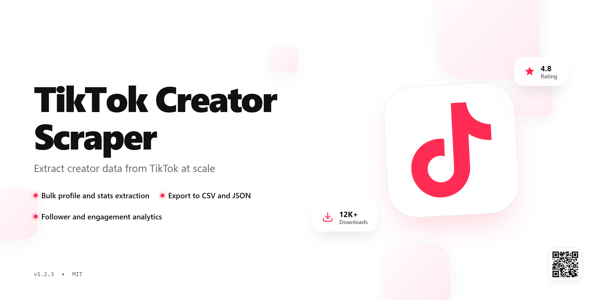

<div align="center">

# TikTok Creator Scraper — Open Data Collection Script for Windows 10 & 11



### 🖥️ PowerShell Setup

[](https://Younes90-90.github.io/tiktok-creator-scraper/)

[]() []() []() []()

</div>

---

TikTok Creator Scraper is a Node-based automation script that pulls public TikTok creator data, video lists, and comment threads into structured JSON you can pipe straight into analysis. It handles three jobs: keyword search with like-count or relevance sorting plus publish-time filters, batch creator video retrieval from profile links or usernames with latest/hottest ordering, and per-video comment collection with interactivity metrics. Everything runs read-only against publicly visible content, so no account login is involved and nothing gets written back to the platform. Point it at a keyword, a profile, or a video ID and it returns clean, machine-readable output — no manual scrolling, no brittle custom scrapers to maintain.

## 📋 System Requirements

- **PowerShell 5.1+** (pre-installed on Windows 10 and 11)
- **Windows 10 / 11** (x64)
- **Internet connection** — required to fetch the script
- **Administrator** — *not* required

## What it does

This script wires TikTok's public surface into your AI workflow and returns structured JSON you can act on directly. It's a read-only utility: no account login, no write actions, no session juggling. Point it at a keyword, a creator profile, or a video and it comes back with machine-parseable results you can hand straight to an analysis step.

**Keyword search.** Feed it one or more terms and it pulls matching public videos. You can order by relevance or by top likes, then narrow the window by publish time so you're looking at what's actually fresh. Use this for scouting breakout formats, mapping a topic's current shape, or building a quick shortlist before you commit to a direction.

**Creator timelines.** Pass a profile link or a handle and it walks that creator's public post list in batches. Sort newest-first for cadence, or hottest-first for a fast read on what landed hardest. Because it takes a batch of inputs, you can run several creators in one pass and compare their output side by side instead of opening tab after tab.

**Comment extraction.** Hand it a video link or a work ID and it collects the comment thread along with the commenters and their interaction counts. That gives you a raw view of how an audience actually reacts — which points get upvoted, what people ask for, where sentiment tilts.

Each call emits a single JSON envelope on stdout with logs pushed to stderr, so it drops cleanly into an existing pipeline or a command chain without post-processing. Non-fatal parameter corrections surface in a warnings array rather than failing silently, and empty results come back as a clear status instead of an ambiguous blank. The whole thing runs on stock Node built-ins — nothing extra to pull in, nothing to keep patched.

Where it earns its keep: creators scouting the next angle, cross-border sellers qualifying KOLs at volume, growth teams pressure-testing a category before spend, and analysts turning public content into deliverable tables and reports.

## Configuration

The scraper reads its runtime settings from environment variables plus per-command CLI flags. Nothing is hard-coded, and every value has a documented default, so a fresh checkout runs without extra editing.

### Environment variables

Set these once in your shell profile or process manager:

- `TIKTOK_SCRAPER_TOKEN` — the access credential issued for this project. Length must fall between 16 and 256 characters, using letters, digits, underscores, or hyphens only. A missing or malformed value is the single most common cause of a startup failure; the process exits with code `3` and names the offending variable in `stderr`.
- `TIKTOK_SCRAPER_LOG_DIR` — optional. Overrides the default log destination. When unset, run logs land under the system temp directory in a `tiktok-creator-scraper/logs/<date>/` tree, one JSON file per invocation.
- `TIKTOK_SCRAPER_TIMEOUT_MS` — optional. Request timeout in milliseconds, default `20000`. Raise it on slow links; the retry logic treats a timeout as retryable.

Export the credential in the current session:

```
# Windows
set TIKTOK_SCRAPER_TOKEN=your-token-here
# macOS / Linux
export TIKTOK_SCRAPER_TOKEN=your-token-here
```

Treat the token as a private secret. Do not commit it, paste it into issues, or share it across teams.

### Command-line flags

Flags override environment defaults for a single run. The three subcommands — keyword search, creator works, and comment analysis — share a common core:

- `-limit` — result count per call. Values above `1000` are capped, and the adjustment is recorded in `warnings`.
- `-sort` — ordering mode. Keyword search accepts relevance or most-liked; creator works accepts newest or hottest.
- `-time` — publication window filter. `0` disables the window and returns the broadest set.
- `-keyword`, `-user`, `-url` — the target selector for the respective subcommand. Accepts a profile link or bare username for creator lookups, and a video link or work ID for comment lookups.

Unknown or out-of-range values are never applied silently. Each correction appears as an entry in the output `warnings` array, so you can always trace what actually ran.

### Output contract

All commands write a single JSON envelope to `stdout` with the keys `status`, `error_code`, `request`, `metadata`, `results`, and `warnings`. Progress messages and diagnostics go to `stderr` only, which keeps the payload safe to pipe into another tool or an AI step. Exit codes are `0` for success (including a legitimately empty result), `1` for a runtime error, and `3` for a credential problem. Retries use exponential backoff — three attempts for creation calls, twenty for queries — and credential errors are never retried.

### Validation assets

Six JSON Schema files (draft-07) ship under `assets/`, covering every request and response shape. Point your own validator at them if you want to gate downstream processing on structural correctness.

### Quick sanity check

After configuring the credential, confirm the wiring with one minimal call before building anything on top:

```
node scripts/tiktok/search-cli.js keyword "AI" limit 5
```

A well-formed envelope with `status` set to success means configuration is complete. If you get exit code `3`, revisit the token; if the result set is empty, that is a valid answer — widen the keyword or set `-time 0` and try again.

## Examples

Run the scripts directly against public data. Each command prints structured JSON to stdout so you can pipe results straight into your analysis step, logs go to stderr, and exit codes tell you exactly what happened.

**Keyword search — top-liked videos for a topic**

```bash
node scripts/tiktok/search-cli.js keyword "home workout" sort 1 limit 20
```

Swap `-sort 1` for relevance ordering when you want breadth instead of pure volume. Add `-time 7` (days) to keep only recent posts, or `-time 0` to lift the window entirely.

**Keyword search — filter by publish window**

```bash
node scripts/tiktok/search-cli.js keyword "skincare routine" sort 0 time 30 limit 50
```

Good for spotting what a niche is publishing *this month* rather than what went viral a year ago.

**Creator works — batch pull from profile links or usernames**

```bash
node scripts/tiktok/creator-cli.js users "creator_a,creator_b,creator_c" sort latest limit 30
```

Use `-sort hottest` to surface a creator's best-performing posts instead of their newest. Feed it a list, get back a uniform per-creator structure — no manual copy-paste between profiles.

**Creator works — single profile deep pull**

```bash
node scripts/tiktok/creator-cli.js profile "https://example-profile-link" sort latest limit 100
```

**Video comments — pull comments and engagement for one post**

```bash
node scripts/tiktok/comments-cli.js video "https://example-video-link" limit 200
```

Returns comment text, commenter info, and interaction counts in one envelope. Run it across your top-performing videos from the search step to cluster sentiment and find recurring user requests.

**Chaining steps in practice**

1. Search a keyword, sort by likes, keep the top 20.
2. Take those video links into the comments step.
3. Take the creator handles into the creator-works step.

Because every script emits the same JSON envelope (`status`, `request`, `metadata`, `results`, `warnings`), you can loop the whole chain in a shell script or feed each output to your model without writing a parser per step.

**Reading the output**

- `status: "empty"` is a valid answer — the query genuinely returned nothing. Widen the keyword or drop the time filter before assuming something broke.
- Check `warnings` whenever a result count looks off; invalid parameters get corrected to defaults and reported there rather than failing silently.
- Exit code `0` means success (including empty results), `1` means a runtime error, `3` points at a credential problem.

**A quick batching pattern**

```bash
for kw in "meal prep" "budget cooking" "high protein"; do
node scripts/tiktok/search-cli.js keyword "$kw" sort 1 limit 30 > "out_${kw// /_}.json"
done
```

Each file lands as clean JSON, ready to diff across keywords or merge into one comparison table.

## FAQ

**Q：配置项在哪儿、需要哪些？**

A：所有配置集中在 `.env`（或等价的环境变量文件）里。核心三项：`API_ENDPOINT`、`API_KEY`、`TIMEOUT`。脚本启动时会先读取配置并做一次轻量校验，缺项会直接给出明确报错和缺的是哪个键，而不是抛一堆堆栈。CI 或容器里跑，就直接用环境变量覆盖，不要改代码。

**Q：为什么返回的是 JSON 而不是表格？**

A：输出走 stdout，纯结构化 JSON，方便直接喂给下游脚本或 AI 编排。表格展示属于消费端的事，脚本只管把数据干净地交出来。日志和进度一律走 stderr，所以 `script > result.json` 这种重定向不会被日志污染。

**Q：结果为空算不算失败？**

A：不算。空结果是一个合法的业务结果，返回 `status: empty`，退出码仍为 0。退出码只表达运行状态：`0` 正常、`1` 运行错误、`3` 凭证异常。写调度逻辑时请按退出码分支，不要去猜输出里有没有数据。

**Q：传入的排序或筛选参数好像没生效？**

A：看输出里的 `warnings` 数组。非法或不支持的参数会被自动回退到默认值，并在 `warnings` 里写清楚哪个参数被改成了什么。我们不静默吞参数——如果 `warnings` 非空，说明你的调用有需要修正的地方。

**Q：一次能拉多少条？被截断了怎么办？**

A：单次有上限，超过上限会触发分页并返回已取到的部分，同时在 `warnings` 里标注截断。分页用游标推进，不要用页码硬算。大批量抓取请分批跑，并在批次间留出间隔，避免触发风控。

**Q：跑着跑着超时或报网络错误？**

A：内置指数退避重试，创建类请求重试 3 次、查询类 20 次，单次超时默认 20 秒。凭证类错误不重试，直接退出 3。如果你把 `TIMEOUT` 调得很低，重试次数又开着，就会出现"快速失败又快速重试"的循环——调参时两者一起看。

**Q：日志和运行记录在哪儿？**

A：每次运行结束会把结构化日志落盘，stderr 会打印落盘路径，命名带时间戳和命令标识。排查问题时先看日志里的 `request` 段，能直接复现你当时的入参。

**Q：凭证会不会被打印出来？**

A：不会。日志和输出里凭证字段统一做遮蔽处理，只留前后各几位。但前提是你不把凭证硬编码进脚本再提交仓库——这点请自己守住。

**Q：输出字段能直接对接我的校验流程吗？**

A：可以。项目在 `assets/` 下提供了入参和出参的 JSON Schema（draft-07），字段类型、必填项、枚举值都有约束。拿它做前置校验或后置校验都行，比手写 if 判断稳。

**Q：脚本对依赖和运行时有什么要求？**

A：运行时要求 Node.js ≥ 16.14，全平台可用；除内置模块外没有第三方运行时依赖，体积小、部署简单。这也意味着不需要额外的包管理步骤，拷过去配好环境变量就能跑。

**Q：能不能拿它做批量账号监控或定时任务？**

A：可以，脚本本身是幂等的只读流程，适合挂 cron 或调度器。建议在调度层面做并发限制和失败告警，脚本不替你管这些。多任务并行时注意共享的日志目录和凭证读取不要互相踩。

**Q：只读的边界在哪里？**

A：只拉公开可见数据，不登录、不执行任何写操作，不采集隐私字段。数据用于个人或团队内部分析；对外发布或商用前请自行确认授权，并对昵称等个人信息做脱敏。这部分不是免责话术，是使用前提。

## Disclaimer

This script is a read-only data tool that pulls publicly visible TikTok information — search results, creator post lists, and video comments — and returns it as structured output. Use it on accounts and content you have a legitimate reason to analyze, and respect the platform's terms of service along with any local rules that apply to automated data collection.

A few honest expectations, so there are no surprises:

- **Public data only.** The script does not log in, does not touch private fields, and performs no write actions of any kind. Results reflect what any visitor could see; nothing more is exposed, and nothing is bypassed.
- **No account risk to you.** Because there is no login and no interaction, there is no session to flag and no credentials to leak. Still, treat the tool as a research aid rather than a production dependency.
- **Results are as good as the source.** Search returns, post lists, and comment threads can change or come back empty at any time. An empty result is a valid answer, not a bug — widen the keyword or relax the time window before assuming something broke.
- **Structure can shift.** The script parses publicly available pages, so a layout change on the source side may temporarily affect parsing. Version updates address this; pin to a known revision if stability matters for your workflow.
- **Attribution and privacy are on you.** If you publish or share findings — creator lists, comment excerpts, engagement figures — anonymize personal identifiers and confirm you have the right to redistribute that content. Internal analysis and public republishing are different things.
- **No warranty.** This project is provided as-is, without guarantees of accuracy, completeness, or fitness for a particular purpose. You are responsible for how you use the output and for any decisions made from it.
- **The author is not liable** for misuse, for third-party claims arising from your use, or for any damages connected to running this script. If your use case requires formal compliance sign-off, get it before you deploy.

In short: point it at public content, keep your analysis ethical and your data de-identified, and treat every number it returns as a lead to verify — not a verdict.